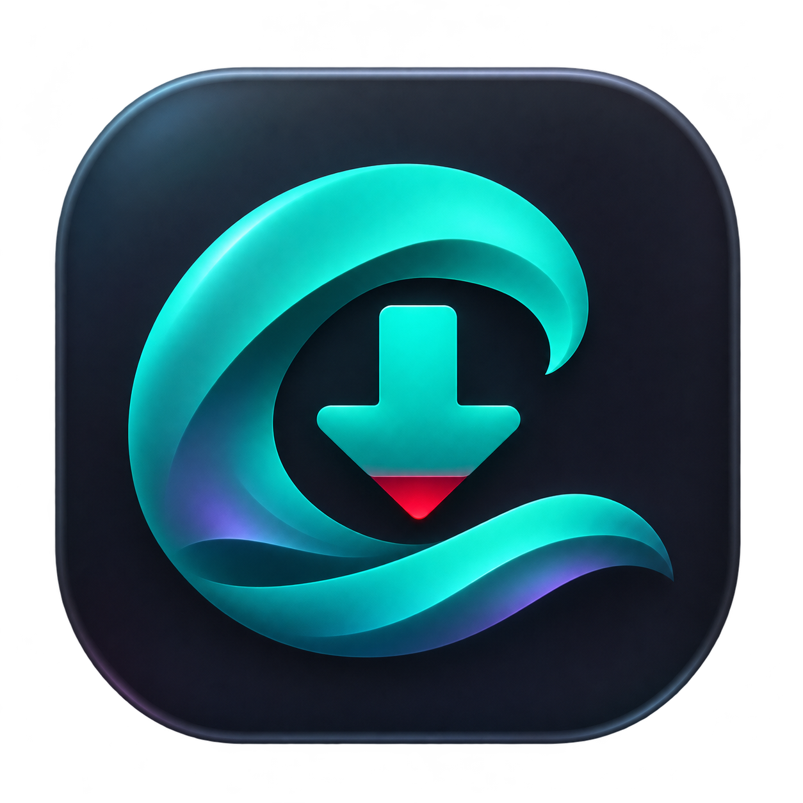

  

<h1 align="center">FetchCove</h1>

Save video, audio, chapters, and subtitles in a native Mac app powered by yt-dlp.

  <strong><a href="https://github.com/WEBServices-ORG/FetchCove/releases/download/v0.9.911-rc.2/FetchCove-v0.9.911-rc.2-arm64.dmg">Download for Apple Silicon (DMG)</a></strong>
  &nbsp;·&nbsp;
  <a href="https://github.com/WEBServices-ORG/FetchCove/releases/download/v0.9.911-rc.2/FetchCove-v0.9.911-rc.2-arm64.zip">ZIP</a>
  &nbsp;·&nbsp;
  <a href="https://github.com/WEBServices-ORG/FetchCove/releases/tag/v0.9.911-rc.2">Release notes</a>

**Release candidate v0.9.911 RC 2 (build 19).** The app is signed with Developer ID and notarized by Apple. It targets macOS 14 or later on Apple Silicon. Runtime testing on macOS 14, spoken VoiceOver checks, and broader yt-dlp option testing are still in progress.

## What you can do

- Save video, audio, or both from one download. Choose a resolution cap, original audio, or 320 kbps MP3.
- Keep the full recording, split it into chapters, or save both. FetchCove can create matching SRT files with chapter-relative timestamps when captions are available.
- Search the yt-dlp option catalog, arrange repeated arguments, and follow live command output in **All options**.

## Install and use

1. Open the DMG and drag **FetchCove** into **Applications**. If you downloaded the ZIP, extract it first and move the app into **Applications**.
2. Install [yt-dlp](https://github.com/yt-dlp/yt-dlp#installation) and [FFmpeg](https://ffmpeg.org/download.html) separately. FetchCove also uses `ffprobe`, which comes with FFmpeg. If you already use Homebrew, run `brew install yt-dlp ffmpeg`.
3. Open FetchCove. In **Tools & Updates**, verify the tool paths and adjust them if your tools are installed elsewhere.
4. Paste a media link, choose what to save and where, then click **Download**. Available formats, chapters, and subtitles depend on the source.

## Feedback and support

[Report a problem](https://github.com/WEBServices-ORG/FetchCove/issues/new) with your macOS version, FetchCove build, yt-dlp version, and steps to reproduce it. Remove private URLs and credentials from anything you share.

[Support FetchCove development](https://www.paypal.com/ncp/payment/VRVYW4BB3CH3L) if you’d like to contribute.

FetchCove is developed by WEBServices. This repository hosts official downloads and release notes.
